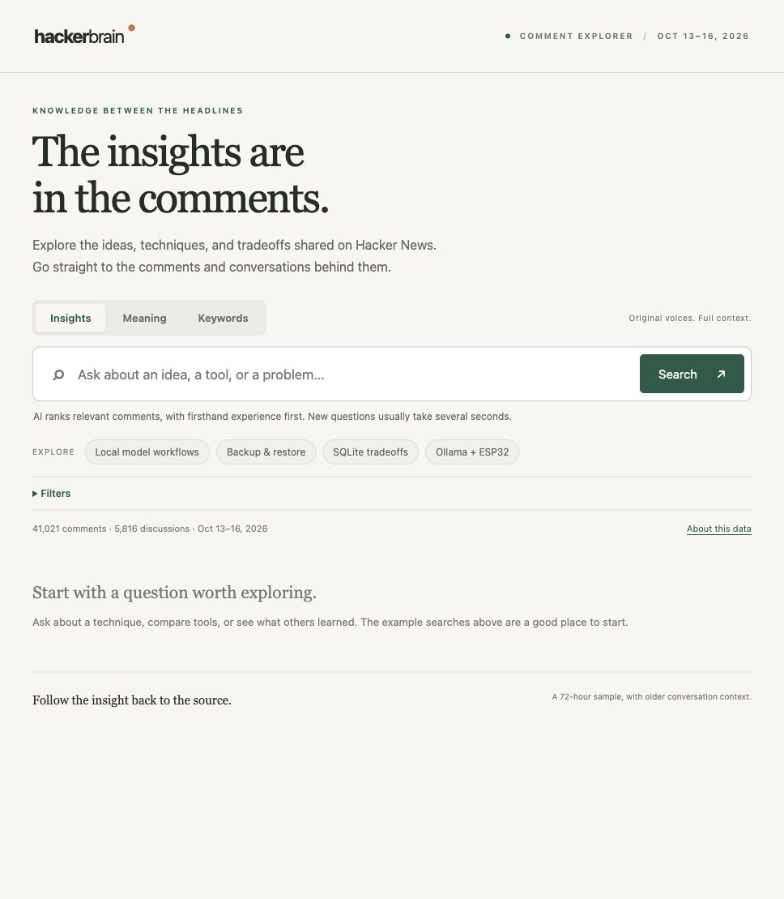
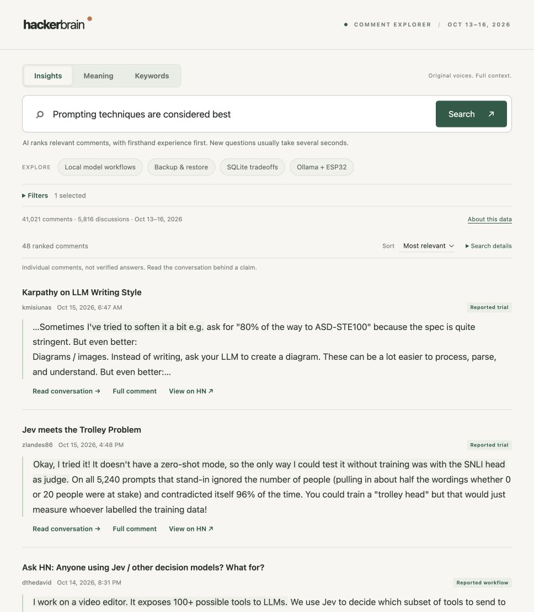
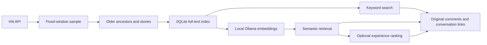

# Hacker Brain

**The insights are in the comments.**

[](https://github.com/daveonkels/hacker-brain/actions/workflows/tests.yml)


Explore the ideas, techniques, and tradeoffs shared in Hacker News comments. Ask a question, find relevant experiences, and follow each insight back to the original conversation.

Hacker Brain starts with a bounded sample of HN and can extend it on demand, restores older parent context, and makes the comments searchable by keywords, meaning, or AI-ranked firsthand experience. Results keep the author's words, attribution, and original comment links.



## What you can explore

- **Workflows:** How are people using local models in their daily work?
- **Techniques:** Which prompting approaches have people found useful?
- **Tradeoffs:** What problems have people run into using SQLite in production?
- **Lessons learned:** How do people back up and restore self-hosted services?

Each result opens the full comment and its collected conversation context: the original story, ancestors, direct replies, and later replies by the same author when present in the sample. Highlighted evidence is copied from source text, never generated as a quotation.



*Screenshots show the October 13–16, 2026 development sample with the optional Decisions provider. The collected dataset is not bundled.*

## Refresh the collection

Press **Refresh HN** below the search controls to pull new stories and comments since the last successful fetch. Progress shows collection, parent context, and semantic indexing; you can keep searching while it runs. Once complete, run your search again to include the new material.

Refresh preserves the original start date and adds to the collection. It rechecks the latest 200 IDs and retries unavailable items, but does not synchronize every older edit or deletion. Unchanged passages reuse their embeddings. A failed or interrupted refresh leaves the previous search indexes live; **Retry refresh** resumes saved work. It requires the same local Nomic model used for the original index and incurs no OpenAI calls.

The data directory must be writable and contain the original exports, `run.json`, collection reports, and both search indexes. Completed updates live in separate generations selected by `current.json`. Keep that directory intact; see [deployment and recovery](DEPLOYMENT.md#automatic-and-manual-data-refresh) for storage and backup details. The homelab deployment refreshes automatically every hour; the button remains available for manual refreshes. Standalone local servers stay manual unless configured otherwise.

## Three ways to search

| Mode | What it does | Requirements |
| --- | --- | --- |
| **Keywords** | SQLite full-text search with stemming, phrases, and all/any word matching | Python and SQLite FTS5 |
| **Meaning** | Finds related passages using local embeddings with a small keyword signal | Ollama, `nomic-embed-text:latest`, and a built semantic index |
| **Insights** | Ranks relevant comments by reported actions, detail, outcomes, and failures; labels workflows, trials, builds, questions, and opinions | Meaning setup, plus local `gemma4:e4b` or the optional custom Decisions integration |

Filters let you require firsthand wording or include older collected comments. The wording filter is a heuristic, not proof of personal experience. AI contribution labels are separate model judgments, not fact checks.

Initial meaning matches appear while Insights ranks candidates. If you start reading, completed ranking waits behind **Show ranked results** instead of replacing the comment under you.

## Get started

The backend uses the Python standard library; the interface uses plain HTML, CSS, and JavaScript. There is no package installation or frontend build step.

Requirements: Python 3.9 or later, SQLite with FTS5 support, and network access to collect public HN items. macOS is the primary development platform; CI runs the offline tests on Linux and macOS. Semantic and Insights modes need additional services as described below.

### 1. Collect a sample and build the search index

```sh
git clone https://github.com/daveonkels/hacker-brain.git
cd hacker-brain

python3 collect_hn.py --hours 72 --workers 16 --output data/hn-72h
python3 context.py --data data/hn-72h
python3 search.py --data data/hn-72h --build
```

The collector reads the [official HN API](https://github.com/HackerNews/API), which needs no API key. Re-running collection in the same directory resumes the **original fixed window**. Use a new output directory for a new sample, and run only one collector per directory. `context.py` recursively fetches missing ancestors and original stories.

### 2. Start the app

```sh
python3 search.py --data data/hn-72h --serve --port 8765
```

Open [localhost:8765](http://127.0.0.1:8765/) and select **Keywords** to search immediately. The interface starts in Insights mode, so switch modes if you have not set up the models yet. The server binds to `127.0.0.1` and stays running in that terminal; Ctrl-C stops it.

### 3. Add semantic search (optional)

Install and start [Ollama](https://ollama.com/), then make `nomic-embed-text:latest` available in it. Model installation is a separate step; this application never downloads models automatically.

With Ollama listening at `http://127.0.0.1:11434`:

```sh
python3 semantic.py --data data/hn-72h
```

Restart the app and choose **Meaning**. Indexing is resumable and covers long comments using overlapping passages. The source fingerprint and model digest must match: after changing the corpus or model, use a new sample directory or explicitly archive the old semantic index before rebuilding.

For fully local **Insights**, also make `gemma4:e4b` available in Ollama. The default server command uses that provider. Local classification can take minutes for a new question; results are cached for repeat searches.

### Optional: OpenAI Decisions

The faster development configuration uses OpenAI Decisions for comment classification and query relevance, while retrieval remains local:

```sh
python3 search.py --data data/hn-72h --serve --port 8765 --reranker decisions
```

**This is currently a custom integration, not a turnkey API-key configuration.** It requires approved Agent Vault configuration. Desktop mode uses the author's external wrapper; the included homelab service runs directly under the broker using `HACKER_BRAIN_DECISIONS_TRANSPORT=proxy`. Without those, use Keywords, Meaning, or local Insights. Setting `OPENAI_API_KEY` alone does not enable this provider.

The adapter in [`decisions.py`](decisions.py) uses `gpt-6-luna` at `/v1/decisions`. It expects the runner at `~/.agents/skills/agent-vault-cli/scripts/luna_vault_run.py`, which executes a bounded batch through a credential-substituting proxy. The source contains a credential placeholder, not a key. A portable transport can implement the same request/response contract; the tests inject a fake transport for offline validation.

This mode sends your question, candidate comments, discussion titles, and limited parent context to OpenAI and incurs API usage. Check service availability and current terms before adapting the transport. Keywords and Meaning remain local after collection.

## Run it on a homelab

For an always-on installation, see [DEPLOYMENT.md](DEPLOYMENT.md). The included Linux service runs the app under Agent Vault, with a separate embedding container and private Tailscale HTTPS. It preserves the current sample and caches without depending on a workstation.

## How it works



Decisions retrieval combines the original question with four deterministic variations, fuses the results, and selects up to **48 candidates** for Quick or **160** for Broader. Reusable comment labels are cached separately from question-specific relevance. Saved shortlists keep pagination stable as new labels are learned. Local Gemma uses its own expanded retrieval path.

Full comments remain available for review. Only the preview is shortened. Deleted and dead items are omitted from search; their markers can remain in conversation context.

## Size, speed, and quality

Measurements from one 72-hour development sample collected October 16, 2026:

| Measurement | Observed result |
| --- | ---: |
| Comments created in the window, including dead/deleted markers | 41,021 |
| Older context items | 4,639 |
| Readable, searchable comments including context | 41,489 |
| Raw compact export / gzip export | 18.21 MB / 6.47 MB |
| Search index / semantic index | 56.15 MB / 172.83 MB |
| Warm semantic query, local engine | About 0.07–0.10 seconds |
| Three fresh Quick Decisions questions, with some static labels reused | 7.7–8.6 seconds |
| Repeated Quick Decisions question, local engine | About 0.05–0.06 seconds |

These are individual development measurements, not latency guarantees. They depend on hardware, model warmup, cached labels, and API response times. Fresh questions do not yet reliably meet a 2–5 second target. Local Gemma reranking can be substantially slower.

On five preselected local-model workflow examples, semantic search placed **2/5** in the first 20 results and Quick Decisions placed **4/5** there. This small set informed development; it is not a held-out benchmark or a general accuracy claim. [Measurement details and limitations](docs/measurements.md).

## Data and privacy

Everything generated during collection, indexing, and search lives under your chosen data directory. `data/`, databases, local environment files, and credentials are excluded from Git.

| File | Purpose |
| --- | --- |
| `run.json`, `chunks/` | Fixed window, resumable scan, and integrity records |
| `items.ndjson`, `items.ndjson.gz` | Available source objects in the collection window |
| `summary.json` | Counts, coverage, and storage measurements |
| `context.ndjson`, `context-summary.json` | Older ancestors and backfill coverage |
| `search.sqlite3` | Full text, relationships, and keyword index |
| `semantic.sqlite3` | Local embeddings and index metadata |
| `rerank.sqlite3` | Cached classifications, relevance judgments, and shortlists |

The HN API exposes current available state, not revision history. The collector retains source HTML as data; the interface displays plain text. Collection is not an atomic snapshot, and deleted text cannot be recovered.

The project does not fetch linked articles, collect user profiles, or enable recurring collection. API-backed ranking sends data externally only when that provider is selected. Local caches can contain your search questions. The server has no authentication and is intended for local use, not direct public hosting.

## Limits to keep in mind

- A time-window sample is not the complete HN archive. Ancestor backfill does **not** retrieve every historical sibling or descendant in a touched thread.
- Item IDs are assumed to be broadly chronological; a boundary guard reduces but does not prove away timestamp anomalies.
- Semantic similarity is not credibility. Reports of local clients, open model weights, and actual local inference can still be confused by ranking.
- Quick ranking trades coverage for speed. Relevant comments outside the shortlist cannot rise to the top.
- In semantic/ranked modes, **Newest** sorts the retrieved result set, not every comment in the collection.
- HN comments remain attributable to their authors. This project is independent of Hacker News and Y Combinator.

## Development

Run the offline tests without Ollama, API access, or a collected dataset:

```sh
python3 -m unittest discover -v
```

If Node.js is already installed, you can also check the frontend syntax with `node --check web/app.js`. No JavaScript dependencies are required.

| File | Responsibility |
| --- | --- |
| `collect_hn.py` | Collection, resume, and size reporting |
| `context.py` | Recursive ancestor backfill |
| `search.py` | SQLite search, conversation context, and local HTTP server |
| `semantic.py` | Embedding index and semantic retrieval |
| `rerank.py` | Local model assessment and ranking |
| `decisions.py` | Optional API assessment, caching, and ranking |
| `web/` | Browser UI |
| `test_*.py` | Offline tests with synthetic fixtures and mocked model responses |
| `evaluate_*.py` | Live development evaluations, requiring a suitable dataset and provider |

The evaluation scripts are separate from the offline suite. `evaluate_semantic.py` expects a local `semantic-evaluation-cases.json` file; `evaluate_rerank.py` also expects its baseline report. Those development artifacts are not bundled. For a configured Decisions installation, `evaluate_decisions.py --data … --query … --output …` evaluates a single question and may incur API charges.

Issues and contributions are welcome, especially around retrieval evaluation, a portable provider interface, and faster question-specific ranking. Include a reproducible case and distinguish actual source evidence from a model's assessment.
